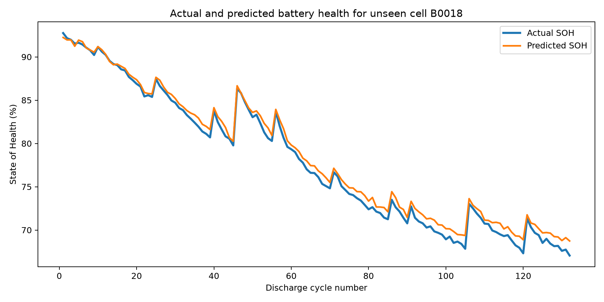
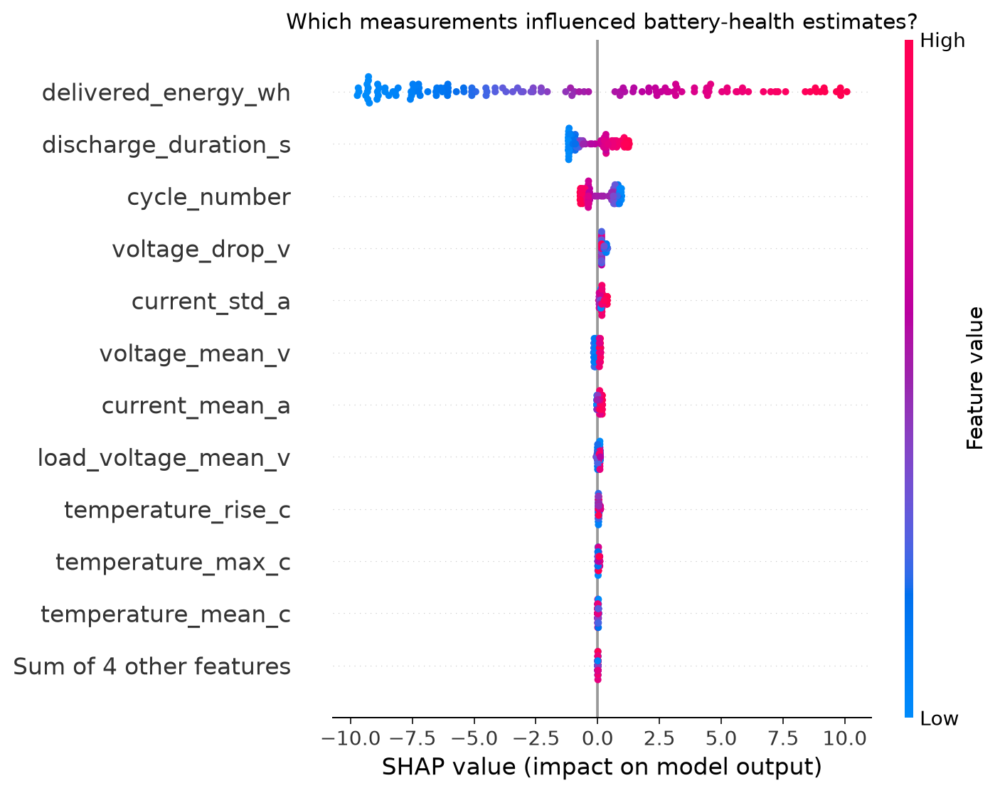
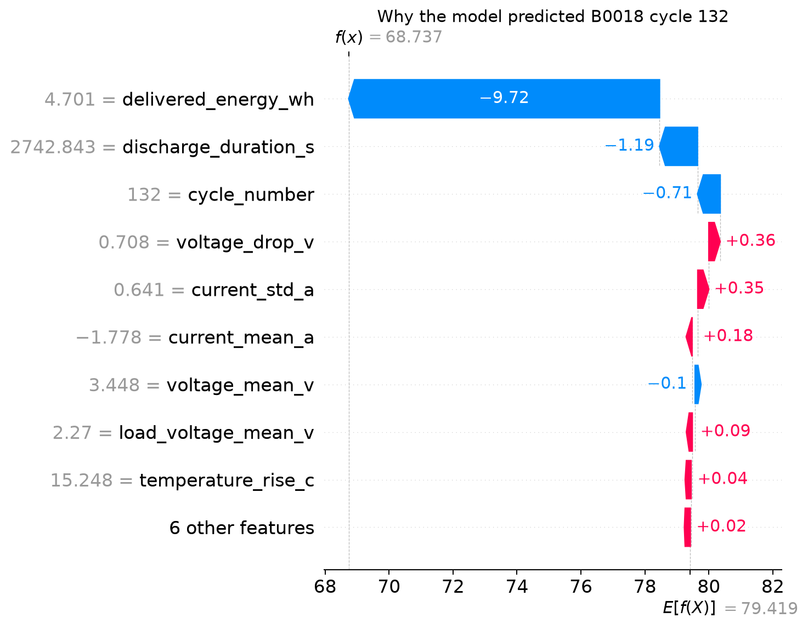

# Explainable EV Battery State-of-Health Prediction

An automotive machine-learning proof of concept that estimates lithium-ion battery State of Health (SOH) and explains a Random Forest model using SHAP and LIME.

> **Scope:** This project uses laboratory cell-aging data. It demonstrates an explainable battery-health workflow; it is not a production-ready EV Battery Management System.

## Problem

A battery can be fully charged while storing less energy than when it was new. State of Health measures this long-term capacity loss:

```text
SOH (%) = Current measured capacity / Original capacity × 100
```

The project predicts SOH from discharge-cycle measurements such as voltage, current, temperature, duration and delivered energy.

## Dataset

The project uses four cells from the **NASA Ames Prognostics Center of Excellence Battery Data Set**:

| Cell | Role | Discharge cycles |
|---|---|---:|
| B0005 | Training | 168 |
| B0006 | Training | 168 |
| B0007 | Training | 168 |
| B0018 | Completely held-out testing | 132 |

The original files contain charge, discharge and impedance operations. This version uses discharge operations and converts each complete discharge into one machine-learning row.

Official catalog: https://data.nasa.gov/dataset/li-ion-battery-aging-datasets

The raw `.mat` files are intentionally excluded from version control. See [DATASET_GUIDE.md](DATASET_GUIDE.md) for file names, checksums and setup information.

## Workflow

```text
NASA .mat files
      ↓
Inspect raw operations and sensors
      ↓
Create 636 cycle-level rows
      ↓
Train on B0005, B0006 and B0007
      ↓
Test on unseen cell B0018
      ↓
Explain the Random Forest with SHAP and LIME
```

## Project files

| File | Purpose |
|---|---|
| `01_understand_dataset.py` | Inspects the raw NASA battery files |
| `02_prepare_data.py` | Creates the cycle-level modeling table |
| `03_train_model.py` | Trains and evaluates the models |
| `04_explain_with_shap.py` | Creates global and local SHAP explanations |
| `05_explain_with_lime.py` | Creates a second local explanation using LIME |
| `run_all.py` | Runs all five stages in order |

## Results

Evaluation was performed only on B0018, which was never used during training.

| Model | MAE (SOH points) | RMSE | R² |
|---|---:|---:|---:|
| Random Forest | 0.698 | 0.794 | 0.989 |
| Linear Regression | 0.350 | — | — |

The Random Forest followed the held-out health trajectory closely, but the simpler Linear Regression achieved lower average error. This is an important result: model complexity should not replace baseline comparison and validation.



## Explainability findings

The strongest Random Forest signals were:

1. Delivered energy
2. Discharge duration
3. Cycle number
4. Voltage drop
5. Current variation



The local SHAP waterfall explains B0018 cycle 132, where the model produced its largest SOH overestimate.



SHAP and LIME explain model behavior; they do not prove physical causation.

## Run locally

```powershell
python -m venv .venv
.venv\Scripts\Activate.ps1
pip install -r requirements.txt
python run_all.py
```

For a step-by-step route, see [HOW_TO_RUN_IN_VSCODE.md](HOW_TO_RUN_IN_VSCODE.md).

## Limitations

- Only four laboratory cells are included.
- The data does not represent a complete EV battery pack or real driving fleet.
- Discharge duration and delivered energy are available after a monitored discharge, so this is a post-cycle diagnostic workflow.
- Pack imbalance, cooling behavior, fast charging, road vibration and changing driving loads are not represented.
- More cell- and pack-held-out validation is required before operational use.

## Tools

Python, pandas, NumPy, SciPy, scikit-learn, Random Forest regression, SHAP, LIME and Matplotlib.

